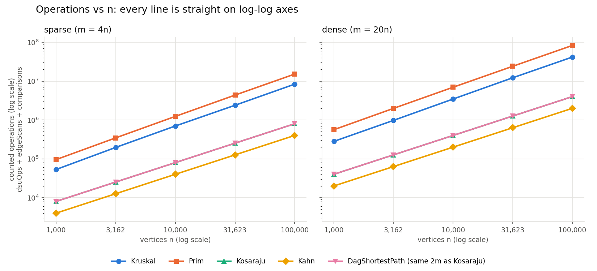
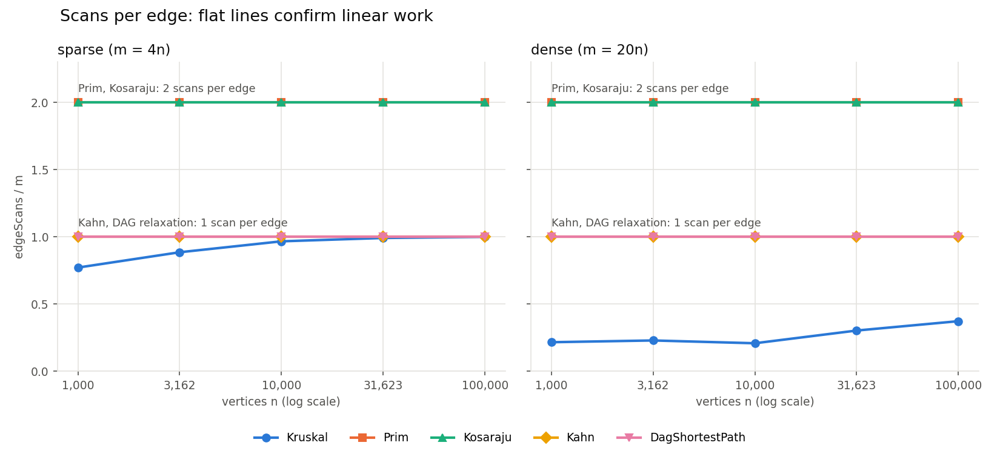
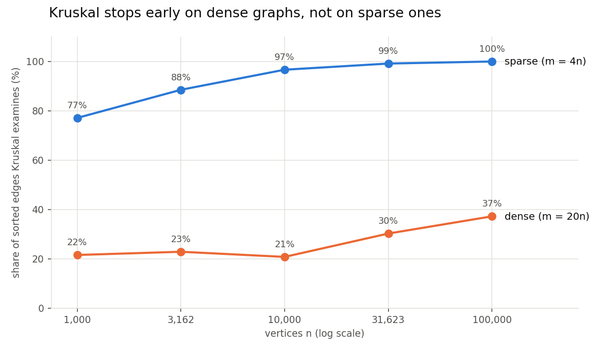

# Assignment 3 — Graphs: DSU, MST, SCC and Shortest Paths

Design and Analysis of Algorithms · Student: _name, group_

All six algorithms (plus Tarjan and the condensation critical path as bonus tasks) run on one
`Graph` class and reproduce every number in the reference table exactly. Every counter below
comes from `results/results.csv`, which one command regenerates:
`./mvnw -q package && java -jar target/graphs.jar && python3 scripts/plots.py`.

## 1. Reference values

The benchmark compares each value with the assignment's table and stops with an error if one
differs. It also stops if Kruskal ≠ Prim, if Kahn's order is invalid, if Tarjan ≠ Kosaraju, or if
the counters change between the 5 repetitions.

| Graph (n / m) | MST total weight | SCC count | Sum of DAG distances | Match |
| --- | ---: | ---: | ---: | :---: |
| 1 000 / 4 000 | 147 970 | 27 | 396 274 | yes |
| 1 000 / 20 000 | 30 363 | 1 | 252 411 | yes |
| 3 162 / 12 648 | 468 911 | 137 | 1 271 911 | yes |
| 3 162 / 63 240 | 97 589 | 1 | 723 157 | yes |
| 10 000 / 40 000 | 1 486 139 | 373 | 3 941 828 | yes |
| 10 000 / 200 000 | 309 550 | 1 | 2 381 342 | yes |
| 31 623 / 126 492 | 4 715 515 | 1 188 | 12 551 891 | yes |
| 31 623 / 632 460 | 968 517 | 1 | 7 376 612 | yes |
| 100 000 / 400 000 | 15 012 094 | 3 923 | 40 096 539 | yes |
| 100 000 / 2 000 000 | 3 056 681 | 1 | 23 512 087 | yes |

Kosaraju scans exactly 2m edges and Kahn and the DAG relaxation exactly m at every size; the
benchmark asserts this.

## 2. Complexity table

V = vertices, E = edges, α = inverse Ackermann function (≤ 4 for any input that fits in memory).

| Algorithm | Time | Extra space | Justification |
| --- | --- | --- | --- |
| DSU find / union | O(α(V)) amortized | O(V) | Union by rank keeps every tree at height ≤ log V; path compression re-hangs each walked vertex on the root; together α(V). |
| Kruskal | O(E log E) | O(V + E) | The merge sort of E edges dominates; the scan does ≤ E edge checks of 2 finds each, O(E α(V)). |
| Prim (lazy, binary heap) | O(E log E) | O(E) | Every adjacency entry is pushed and popped at most once; each heap operation is O(log E). |
| Kosaraju | O(V + E) | O(V + E) | Two DFS passes, each edge looked at once per pass; the reversed graph needs O(V + E). |
| Kahn | O(V + E) | O(V) | Each vertex enters the queue once; each edge lowers one in-degree once. |
| DAG shortest paths | O(V + E) | O(V) | One topological sort, then one relaxation per edge in topological order. |
| Tarjan (bonus) | O(V + E) | O(V) | One DFS pass, each edge looked at once, no reversed graph. |

## 3. Counters vs formulas

Each cell is a measured counter divided by the formula from the complexity table. A ratio that
stays flat as n grows 100× confirms the complexity class.

| Algorithm | Ratio | Density | n=1 000 | n=3 162 | n=10 000 | n=31 623 | n=100 000 |
| --- | --- | --- | ---: | ---: | ---: | ---: | ---: |
| Kosaraju | edgeScans / (V+E) | sparse | 1.600 | 1.600 | 1.600 | 1.600 | 1.600 |
| Kosaraju | edgeScans / (V+E) | dense | 1.905 | 1.905 | 1.905 | 1.905 | 1.905 |
| Kahn | edgeScans / (V+E) | sparse | 0.800 | 0.800 | 0.800 | 0.800 | 0.800 |
| Kahn | edgeScans / (V+E) | dense | 0.952 | 0.952 | 0.952 | 0.952 | 0.952 |
| DAG shortest paths | edgeScans / (V+E) | sparse | 0.800 | 0.800 | 0.800 | 0.800 | 0.800 |
| DAG shortest paths | edgeScans / (V+E) | dense | 0.952 | 0.952 | 0.952 | 0.952 | 0.952 |
| Kruskal | dsuOps / edges examined | sparse | 2.324 | 2.283 | 2.259 | 2.252 | 2.250 |
| Kruskal | dsuOps / edges examined | dense | 2.232 | 2.219 | 2.241 | 2.166 | 2.134 |
| Kruskal | comparisons / (E log₂ E) | sparse | 0.896 | 0.928 | 0.940 | 0.926 | 0.949 |
| Kruskal | comparisons / (E log₂ E) | dense | 0.935 | 0.922 | 0.946 | 0.953 | 0.942 |
| Prim | comparisons / (E log₂ E) | sparse | 1.829 | 1.865 | 1.895 | 1.921 | 1.934 |
| Prim | comparisons / (E log₂ E) | dense | 1.825 | 1.847 | 1.866 | 1.878 | 1.890 |

- **Traversals.** edgeScans/(V+E) is identical to three decimals at every n. The value is
  2m/(n+m) = 2·4/5 = 1.6 for Kosaraju (two passes) and m/(n+m) = 0.8 for Kahn (one pass).
- **DSU.** Kruskal does about 2.25 DSU operations per examined edge (2 finds + a union on 1 edge
  in 4) at every size. The cost per operation does not grow with n, which is what α(n) predicts.
  dsuOps / E itself is not flat (1.79 → 2.25 sparse, 0.48 → 0.79 dense) because Kruskal stops
  early: it examines a growing share of the edges (Section 6, plot 3). Per edge it actually looks
  at, the cost is constant.
- **Sorting and heap.** Both MST algorithms stay near a constant multiple of E log E: about 0.94
  for Kruskal's merge sort and about 1.9 for Prim's binary heap (≈ 2 comparisons per sift level).

### Slope check

Least-squares slope of log(counter) against log(n) over the five sizes:

| Algorithm | Counter | Sparse | Dense |
| --- | --- | ---: | ---: |
| Kosaraju | edgeScans | 1.000 | 1.000 |
| Kahn | edgeScans | 1.000 | 1.000 |
| DAG shortest paths | edgeScans | 1.000 | 1.000 |
| Prim | edgeScans | 1.000 | 1.000 |
| Kruskal | edgeScans | 1.055 | 1.119 |
| Kruskal | comparisons (sort) | 1.105 | 1.087 |
| Prim | comparisons (heap) | 1.108 | 1.090 |

The traversals give exactly **1.00**: linear work. Kruskal is steeper, **1.10 (sparse) and 1.09
(dense)** for its sorting comparisons, because of the log factor in E log E. Over n = 10³…10⁵,
log E grows from about 12 to 21, which adds about 0.1 to the slope. Kruskal's edgeScans slope
(1.06 / 1.12) is above 1 for a different reason: the early-stop share rises with n.

## 4. Correctness arguments

**Cut property (Kruskal and Prim).** Take any cut (S, V∖S) and let e be a lightest edge
crossing it. Suppose some MST T does not contain e. Adding e to T closes a cycle, and that
cycle must cross the cut a second time through some edge f. Since e is a lightest crossing
edge, w(e) ≤ w(f), so T − f + e is a spanning tree that is no heavier: an MST containing e.
Hence the lightest crossing edge is always safe to add. Prim applies the property to the cut
(tree, rest): the heap returns the lightest edge leaving the current tree, and edges with both
ends inside are skipped. Kruskal applies it to the cut (component of u, everything else). When
it reaches edge (u, v) with find(u) ≠ find(v), every lighter edge has already been processed, so
no lighter edge crosses that cut. Both algorithms therefore build an MST, and on the same graph
their totals must be equal, which the benchmark checks on every graph.

**Induction on the topological order (DAG shortest paths).** Let v₁, …, vₙ be the topological
order. Claim: when vₖ is processed, dist[vₖ] is already the true shortest distance δ(vₖ). The
base case is the sources: δ = 0 by the super-source definition, and no edge enters them. For
the step, take a shortest path to vₖ whose last edge is (u, vₖ). Every edge goes forward in the
order, so u = vⱼ with j < k. By the hypothesis, dist[u] = δ(u) when u was processed, and
relaxing (u, vₖ) then set dist[vₖ] ≤ δ(u) + w = δ(vₖ). A distance never drops below the true
value, so dist[vₖ] = δ(vₖ), and later relaxations cannot change it. One pass is therefore
enough: no vertex is ever needed again after it has been processed.

**Why negative weights are safe in a DAG but not in general.** The induction never assumed
w ≥ 0. It only used the fact that all edges into vₖ come from earlier vertices, and a DAG has
no cycle, so no negative cycle can exist either. In a general graph, a cycle lets a path return
to a vertex already processed. A negative cycle makes "shortest" undefined, since every lap
lowers the cost. Even without one, Dijkstra's greedy "the closest unsettled vertex is final"
breaks, because a later negative edge can undercut it. That case needs Bellman-Ford,
O(V·E). The tests check the DAG pass against Bellman-Ford on 200 random DAGs with weights in
[−10, 20].

## 5. Which algorithm when

| Situation | Choose | Why |
| --- | --- | --- |
| MST, sparse graph (E ≈ V), edges given as a list | **Kruskal** | Needs only the edge list and a DSU; the sort is cheap. It did about half of Prim's comparisons in every run here. |
| MST, dense graph (E ≫ V) stored as an adjacency list or matrix | **Prim** | Grows from one vertex, never builds or sorts the global edge list. Near-complete graphs: the O(V²) array version of Prim does no sorting at all. |
| MST, edges already sorted, or arriving over time | **Kruskal** | The sort is gone; the rest is O(E α(V)) with the DSU. |
| "Are a and b connected?" while roads keep being added | **DSU** alone | O(α(n)) per query, no traversal at all. |
| Directed graph, cycles possible: find deadlocks | **Tarjan** (or Kosaraju) | Both O(V + E). Tarjan does one pass (m scans versus 2m) and needs no reversed copy. Kosaraju is simpler to explain and to get right. |
| Job order, a cycle may exist | **Kahn** | Produces the order and detects a cycle in the same O(V + E) pass: fewer than n vertices leave the queue. |
| Fastest or slowest route through a pipeline known to be acyclic, any weights | **Relaxation in topological order** | O(V + E), negative weights allowed. For the longest (critical) path, flip the sign. |
| Shortest path, cycles possible, weights ≥ 0 | **Dijkstra** | O(E log V); the DAG pass needs an order that does not exist. |
| Shortest path, cycles and negative weights | **Bellman-Ford** | O(V·E), and it detects negative cycles. Alternatively, condense the SCCs first if the cycles can be collapsed. |

On the counters, Kruskal beat lazy Prim at both densities. On the dense graphs it stopped after
21–37 % of the sorted edges (plot 3). Prim's heap still received almost every edge. Prim's real
advantages are input-dependent: it needs no edge list, and its O(V²) form suits near-complete
graphs. A density of 20n is not near-complete.

## 6. Plots

**Operations vs n** (log-log; dsuOps + edgeScans + comparisons). Every line is straight. The
traversals have slope 1; Kruskal and Prim sit higher and slightly steeper because of the
log factor.

**Scans per edge** (edgeScans / m). Prim and Kosaraju scan exactly 2 per edge (Prim sees each
undirected edge from both ends; Kosaraju makes two passes). Kahn and the DAG relaxation scan
exactly 1. Flat lines confirm linear work.

**Share of edges Kruskal examines.** On sparse graphs Kruskal needs almost the whole sorted list
(77 % → 100 %), because some vertex's only cheap connection is its spanning-tree edge with a
high weight. On dense graphs every vertex has about 40 incident edges, so a light one almost
always exists and Kruskal stops after 21–37 % of the list. The sort, though, still touches every
edge. That is why Kruskal wins clearly when the edges come sorted. When they do not, the gap to
Prim is the factor of about 2 in heap comparisons, not a different complexity class.

## 7. A paragraph on time

On one laptop (JDK 25, median of 5 runs after one warm-up), the largest dense graph
(10⁵ / 2·10⁶) took 163 ms for Kruskal, 1 156 ms for Prim, 119 ms for Kosaraju, 32 ms for the
DAG shortest paths and 10 ms for Kahn. The ordering agrees with the counters, but the size of
the gaps does not. Prim is about 7× slower although it does only about 2× the comparisons,
because its PriorityQueue boxes every edge id as an Integer and pays for allocation and cache
misses that no counter sees. Kosaraju's time also includes building the reversed graph. On the
two smallest graphs the clock is mostly noise: Kahn reported 0.27 ms at n = 1 000 and 0.03 ms
at n = 3 162, before and after the JIT compiled it. These numbers would change with other
hardware, another JVM or background load. The counters are identical on every machine, so the
conclusions above rest on them.

## 8. Bonus

**Task A: Tarjan.** Tarjan returns the same partition as Kosaraju on all 10 benchmark graphs and
on 100 random test graphs. It scans exactly **m** edges where Kosaraju scans **2m**
(`results/bonus_tarjan.csv`), e.g. 2 000 000 versus 4 000 000 on the largest graph. The
saving has two sources. Lowlink values identify each SCC root during the first and only DFS, so
no second pass over the reversed graph is needed. And no reversed copy of the graph is built,
which also saves O(V + E) memory.

**Task B: condensation and critical path.** Collapsing each SCC to one vertex always gives a
DAG: a cycle between two components would merge them into one SCC. On the largest sparse graph
the condensation has 3 923 vertices and 15 524 edges. Its longest path has weight 4 977 over 8
components (`results/bonus_critical_path.csv`); dense graphs collapse to a single component.
The longest path is found by negating every weight and running the same O(V + E) DAG pass.
That is valid because a DAG has no cycles, positive or negative. In a general graph, the longest
simple path is NP-hard: a positive cycle can be repeated forever, and forbidding repeats turns
it into Hamiltonian path. In scheduling, this path is the critical path of the job pipeline. Its
length is the shortest possible completion time even with unlimited parallel workers, and any
delay on it delays the whole project, which is what CPM and PERT use it for.
